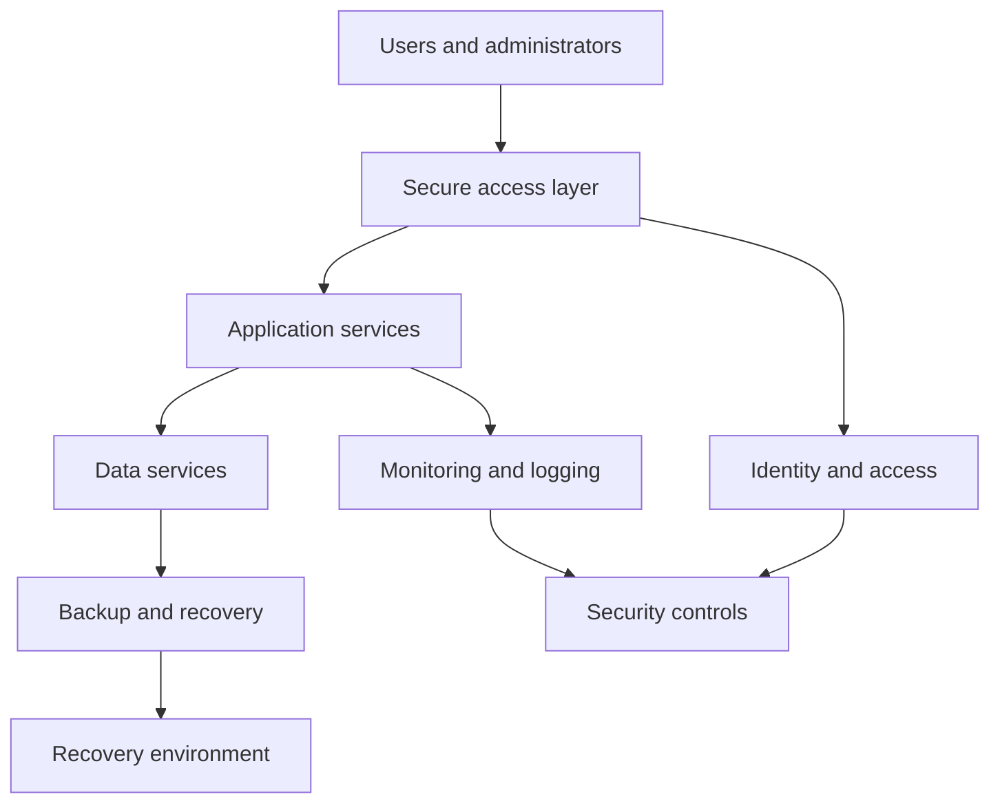

# Infrastructure Architecture

**Enterprise infrastructure | Hybrid cloud | Resilience | Security | Operations**

A practical portfolio of reference architectures, architecture decision records and operational design patterns for enterprise IT infrastructure.

> Scope: independent reference material and personal labs. All diagrams and examples use synthetic environments and are not representations of any employer or customer environment.

## Focus areas

- Enterprise infrastructure architecture and platform lifecycle
- Hybrid infrastructure and cloud integration
- High availability, backup, disaster recovery and business continuity
- Identity, privileged access and security-by-design
- Network segmentation, DNS, load balancing and connectivity
- Monitoring, observability, capacity and operational readiness
- Architecture governance, technical debt and lifecycle planning

## Reference architecture: resilient hybrid workload

The following conceptual diagram is intentionally generic:



## Architecture principles

1. **Secure by default:** least privilege, strong identity, segmentation and auditable administration.
2. **Resilience by design:** identify failure domains, dependencies, recovery objectives and tested restoration paths.
3. **Operate what is designed:** monitoring, alerting, support ownership, runbooks and lifecycle management are design requirements.
4. **Document decisions:** record context, options, rationale, trade-offs and review triggers.
5. **Automate repeatable work:** use version-controlled, reviewable configuration and tested automation where appropriate.

## Suggested repository structure

```text
.
├── README.md
├── docs/
│   ├── architecture-principles.md
│   ├── adr-template.md
│   ├── resilience-checklist.md
│   └── operational-readiness.md
├── diagrams/
└── labs/
```

## Architecture decision record (ADR)

For each significant design decision, record:

| Field | Description |
|---|---|
| Status | Proposed, accepted, superseded or rejected |
| Context | The problem, constraints and drivers |
| Decision | The selected option |
| Alternatives | Other options considered |
| Consequences | Benefits, risks and trade-offs |
| Review trigger | What would cause this decision to be revisited |

## Published architecture artefacts

- [Hybrid infrastructure reference architecture](docs/HYBRID-REFERENCE-ARCHITECTURE.md)
- [Architecture decision record template](docs/ADR-TEMPLATE.md)
- [Resilience and disaster recovery checklist](docs/RESILIENCE-AND-DR-CHECKLIST.md)
- [Operational readiness assessment](docs/OPERATIONAL-READINESS-ASSESSMENT.md)

## Roadmap

- [x] Publish architecture principles and an ADR template
- [x] Add a hybrid infrastructure reference design
- [x] Add a resilience and disaster-recovery checklist
- [x] Add an operational-readiness assessment
- [ ] Add a synthetic infrastructure capacity-planning example

All examples are conceptual and synthetic. Validate designs against business requirements, vendor documentation and security governance before real-world use.
