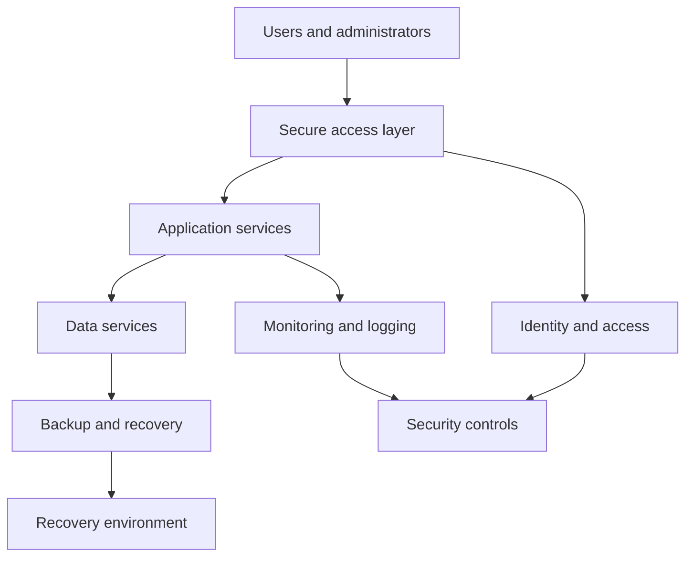

# Infrastructure Architecture

**Enterprise infrastructure | Hybrid cloud | Resilience | Security | Operational design**

I bring more than 20 years of enterprise IT experience across infrastructure architecture, datacenter services, networking and technology delivery. In professional roles, my work has involved understanding complex existing environments, coordinating infrastructure workstreams and supporting modernisation across on-premises, datacenter and hybrid-cloud platforms.

This repository translates the architecture disciplines relevant to that work into reusable, publication-safe reference material. It is a professional portfolio of methods and design thinking—not a collection of customer production designs.

## Professional perspective

The architecture work I value most connects design decisions to delivery and operations:

- **Start with the environment:** establish service ownership, dependencies, constraints, lifecycle and operational requirements before selecting a target design.
- **Design for resilience:** consider failure domains, availability, backup, recovery objectives and tested restoration paths.
- **Make security part of the design:** apply least privilege, identity controls, segmentation and auditable administration.
- **Design for supportability:** include monitoring, alerting, runbooks, ownership, capacity and lifecycle from the outset.
- **Make trade-offs explicit:** document options, constraints, rationale, consequences and review triggers.

## Conceptual hybrid reference architecture

The diagram below is illustrative and uses generic components. It is not a depiction of an employer or customer environment.

## Architecture capabilities represented here

- Enterprise infrastructure architecture and platform lifecycle
- Hybrid infrastructure and cloud integration
- High availability, backup, disaster recovery and business continuity
- Identity, privileged access and security-by-design
- Network segmentation, DNS, load balancing and connectivity
- Monitoring, observability, capacity and operational readiness
- Architecture governance, technical debt and lifecycle planning

## Published architecture artefacts

| Artefact | Why it matters |
|---|---|
| [Hybrid infrastructure reference architecture](docs/HYBRID-REFERENCE-ARCHITECTURE.md) | Shows a structured way to describe a hybrid target state and its key design domains |
| [Architecture decision record template](docs/ADR-TEMPLATE.md) | Captures context, options, rationale, trade-offs and consequences |
| [Resilience and disaster recovery checklist](docs/RESILIENCE-AND-DR-CHECKLIST.md) | Connects availability design with recovery and operational validation |
| [Operational readiness assessment](docs/OPERATIONAL-READINESS-ASSESSMENT.md) | Checks whether a solution can be supported after implementation |
| [Synthetic capacity-planning example](docs/SYNTHETIC-CAPACITY-PLANNING.md) | Demonstrates a planning method using illustrative data |

## How I approach an architecture decision

| Step | Key question |
|---|---|
| Context | What business service, constraints and dependencies are in scope? |
| Options | Which viable patterns meet the functional and non-functional needs? |
| Decision | Why is the selected option appropriate? |
| Consequences | What are the operational, security, cost and lifecycle trade-offs? |
| Validation | How will the design be tested and accepted? |
| Review | What change would trigger reassessment? |

## Scope and responsible publication

All diagrams, sample records and examples in this repository are conceptual or synthetic. They are not customer deliverables, production configurations or evidence of a specific deployment. They are intended to demonstrate how I structure infrastructure architecture decisions and communicate technical considerations. Real designs must be validated against the actual business requirements, vendor documentation, security standards and operational governance.
