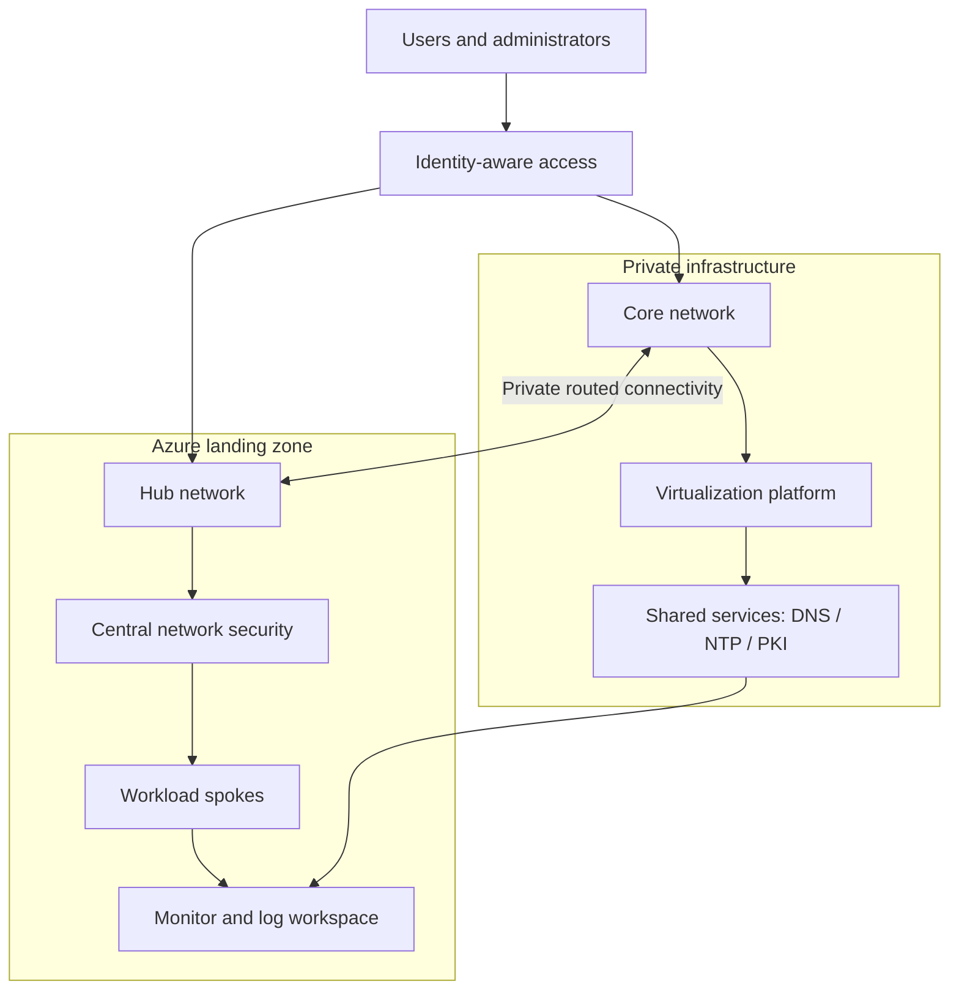

# Hybrid Infrastructure Reference Architecture

> Conceptual portfolio design only. All names and components are illustrative; this is not a customer or production architecture.

## Context and design goals

A fictional enterprise needs to host workloads across an on-premises environment, a colocation facility and Azure. The architecture must support secure connectivity, predictable operations, recoverability and controlled modernization.

## Logical architecture

## Architecture layers

| Layer | Design considerations |
|---|---|
| Identity | Central identity, MFA, conditional access, privileged identity separation |
| Connectivity | Redundant private connectivity, documented routing, controlled DNS forwarding |
| Network | Hub-and-spoke or equivalent segmentation, explicit ingress/egress, deny-by-default |
| Compute | Standardized images, patching, capacity reservations and lifecycle ownership |
| Data | Classification, encryption, backup, retention and recovery testing |
| Security | Central policy, endpoint protection, vulnerability management, audit logging |
| Operations | Monitoring, alert routing, service ownership, CMDB and runbooks |

## Availability and failure domains

- Avoid single points of failure in critical connectivity, identity and shared services.
- Define availability requirements per service rather than applying one pattern to all workloads.
- Understand dependencies on power, carrier, DNS, identity, control plane and regional services.
- Test recovery in a separate failure domain and document actual recovery evidence.

## Security guardrails

1. Use least privilege and separate daily administration from privileged operations.
2. Restrict management paths to approved access systems and source networks.
3. Apply segmentation between user, application, data and management zones.
4. Centralize logs with protected retention and alert ownership.
5. Review secrets, certificates and service identities as lifecycle-managed assets.
6. Require security review for exceptions and time-bound firewall rules.

## Key decisions to record

- Connectivity model and routing ownership
- IP address management and DNS strategy
- Identity integration and privileged access model
- Workload placement and migration disposition
- Backup, recovery and data residency requirements
- Monitoring, logging and operational support model

## Validation checklist

- [ ] Business and technical requirements approved
- [ ] Current and target dependencies documented
- [ ] Failure domains and recovery objectives reviewed
- [ ] Network flows and trust boundaries approved
- [ ] Identity and privileged access tested
- [ ] Logging and monitoring ownership agreed
- [ ] Backup restoration and recovery exercised
- [ ] Operational handover and lifecycle owners identified
